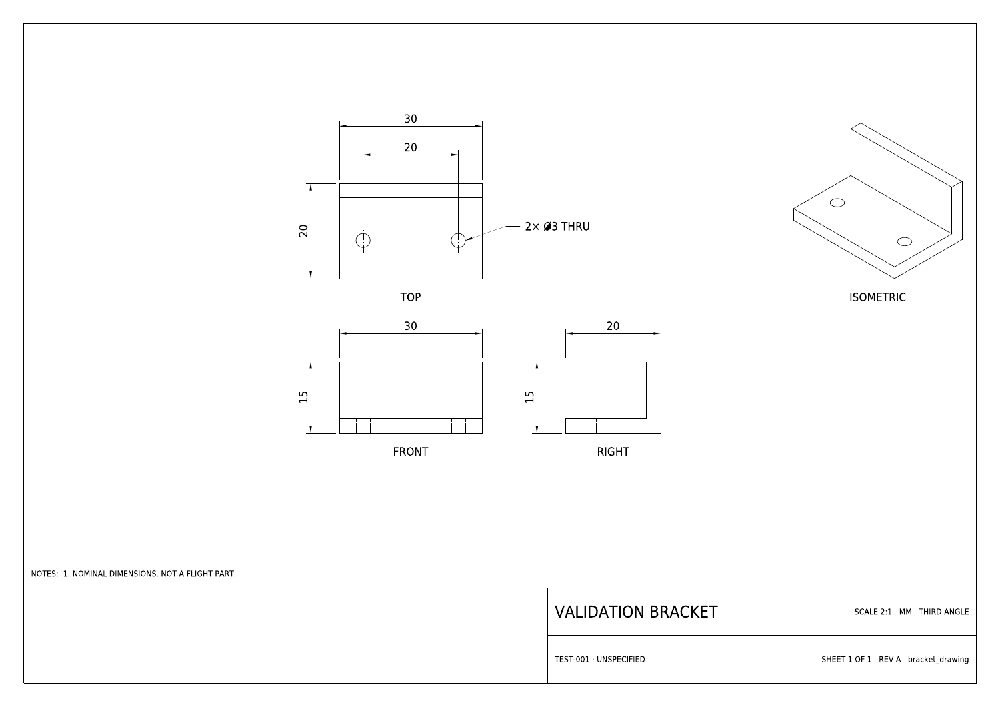

# Parametric CAD examples

Small code-first CAD projects for exercising a design-to-export workflow. The models are generic examples with nominal dimensions in millimetres.

| Example | What it demonstrates |
| --- | --- |
| [Angle bracket](examples/text-to-cad/bracket.py) | Parametric solid construction and STEP, STL, and 3MF export |
| [Bracket drawing](examples/text-to-cad/bracket_drawing.py) | Dimensioned engineering views derived from the STEP model |
| [Fit coupon](examples/additional-skills/fit_coupon.py) | Five trial bore diameters for measuring physical fit |
| [Hole template](examples/additional-skills/hole_template.py) | A dimensioned sketch exported to DXF |



## Generate the files

With uv installed, run the examples using the pinned CADGen version. The drawing reads the generated STEP file from its example directory.

```sh
cd examples/text-to-cad
DO_NOT_TRACK=1 CADGEN_TELEMETRY=0 uvx --python 3.13 --from cadgen==0.7.26 python bracket.py
DO_NOT_TRACK=1 CADGEN_TELEMETRY=0 uvx --python 3.13 --from cadgen==0.7.26 python bracket_drawing.py
cd ../additional-skills
DO_NOT_TRACK=1 CADGEN_TELEMETRY=0 uvx --python 3.13 --from cadgen==0.7.26 python fit_coupon.py
DO_NOT_TRACK=1 CADGEN_TELEMETRY=0 uvx --python 3.13 --from cadgen==0.7.26 python hole_template.py
```

Verify a coupon with your own printer, material, and measured hardware before using an allowance in a part.
